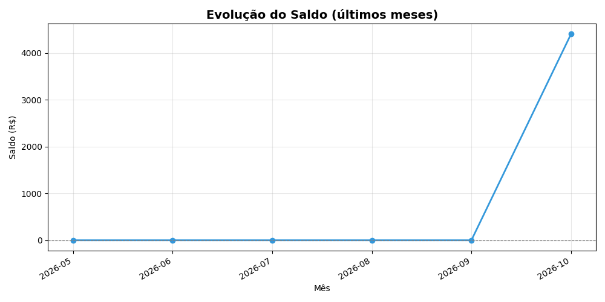
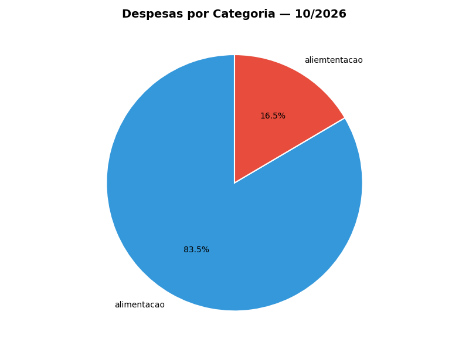

# 💰 Finanças Pessoais

[](https://github.com/danielalves1677/financas-pessoais/actions/workflows/ci.yml)
[](https://www.python.org/)
[](LICENSE)
[]()

Gerenciador de finanças pessoais em Python com arquitetura limpa, testes automatizados e suporte a múltiplos backends de persistência (JSON e SQLite).

## ✨ Funcionalidades

- ➕ **Transações** — cadastro de receitas e despesas com categorias
- 🎯 **Orçamentos** — limite mensal por categoria com alertas em 80% e 100%
- 📈 **Metas** — acompanhamento com prazo, progresso e cálculo de valor mensal necessário
- 📊 **Gráficos** — evolução do saldo, pizza de categorias, comparativo mensal, progresso de metas e status de orçamentos
- 🔌 **Backends plugáveis** — JSON ou SQLite, escolhidos por variável de ambiente

## 🏗️ Arquitetura

```
src/financas/
├── models/         # Entidades validadas com Pydantic
├── repositories/   # Persistência (JSON e SQLite) — mesmo contrato
├── services/       # Regras de negócio
├── cli/            # Interface de linha de comando
├── relatorios/     # Geração de gráficos com matplotlib
├── config/         # Configurações centralizadas
└── utils/          # Formatadores e validadores
```

Segue os princípios de **Clean Architecture** e **SOLID**:
- Modelos não conhecem persistência
- Repositórios são intercambiáveis (mesma interface)
- Serviços não conhecem CLI nem banco
- Fácil trocar de backend sem tocar em nada além do repositório

## 🚀 Como rodar

### 1. Clone e instale

```bash
git clone https://github.com/danielalves1677/financas-pessoais.git
cd financas-pessoais

python -m venv .venv
# Linux/Mac:
source .venv/bin/activate
# Windows (PowerShell):
.venv\Scripts\Activate.ps1

pip install -r requirements.txt
pip install -e .
```

### 2. Execute

```bash
python -m financas
```

### 3. Escolha o backend (opcional)

Por padrão, o app usa **JSON**. Para usar **SQLite**:

```bash
# Linux/Mac:
DB_BACKEND=sqlite python -m financas

# Windows (PowerShell):
$env:DB_BACKEND="sqlite"; python -m financas
```

## 🧪 Testes

```bash
pytest -v
```

Os testes rodam **parametrizados nos dois backends** (JSON e SQLite) — **66 testes**, cobertura de 100% nas camadas críticas (`services`, `sqlite_repository` e `models`).

```bash
# Cobertura detalhada
pytest --cov=financas --cov-report=term-missing

# Apenas testes de um backend
pytest -v -k sqlite
pytest -v -k json
```

## 📸 Screenshots

*(Adicione prints dos gráficos gerados aqui depois — copie os PNGs de `data/graficos/` para uma pasta `docs/` e referencie abaixo.)*

<!--
Exemplo:


-->

## 🛠️ Stack

- **Python 3.10+**
- **Pydantic 2** — validação de dados
- **SQLAlchemy 2** — ORM
- **matplotlib** — gráficos
- **pytest** — testes
- **GitHub Actions** — CI/CD

## 📋 Roadmap

- [x] Fase 1 — Arquitetura modular + testes
- [x] Fase 2 — SQLite + SQLAlchemy
- [x] Fase 3 — Orçamentos e metas
- [x] Fase 4 — Gráficos com matplotlib
- [ ] Fase 5 — Interface gráfica (CustomTkinter)
- [ ] Fase 6 — App web (Streamlit)
- [ ] Fase 7 — IA e Open Finance

## 📄 Licença

[MIT](LICENSE) — use, modifique, distribua à vontade.